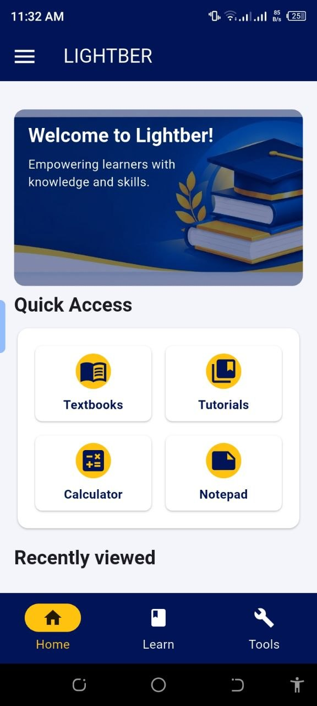
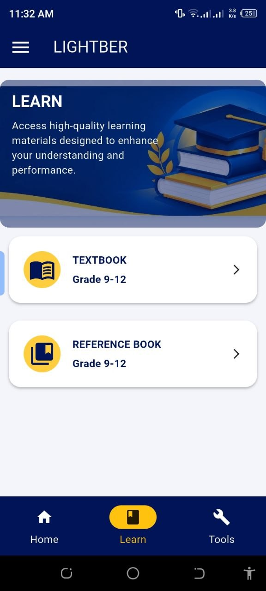
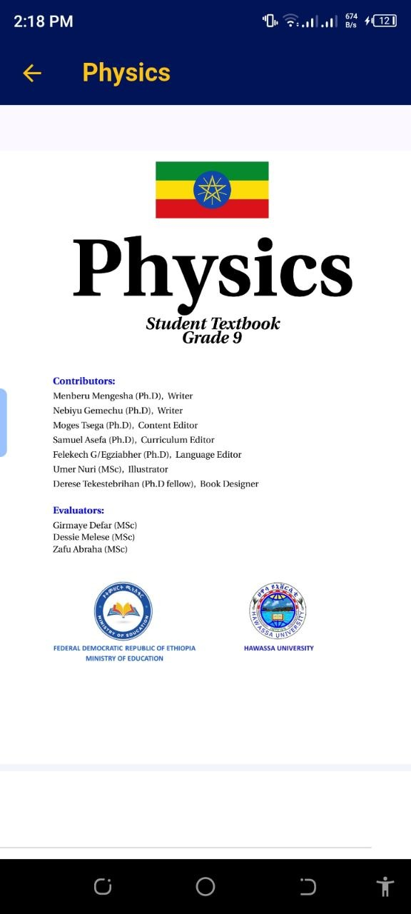
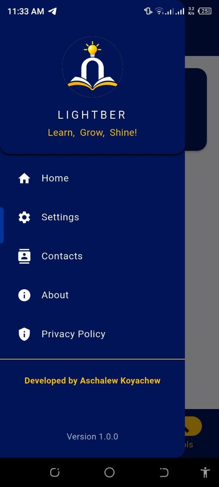

# Lightber-learn
Flutter educational app
Learn, Grow, Shine! – An educational Flutter app for Grade 9-12 students.

## Features
- Student textbooks and reference books by grade
- Offline textbook download
- Built-in calculator and notepad
- Recently viewed section
- Contact, About and Privacy Policy pages
## Built with
Flutter, Dart, Supabase

## Skills
- Specialization: Flutter and Dart (Mobile)
- Backend: Supabase
- Web: HTML, CSS, JavaScript
- Languages: C++, Java, C#

## Developer
Aschalew Koyachew
Information Systems student, Bahir Dar Institute of Technology
##Screenshots
##Home Screen

##Learn Screen

##Books viewer screen

##Sidebar Screen
